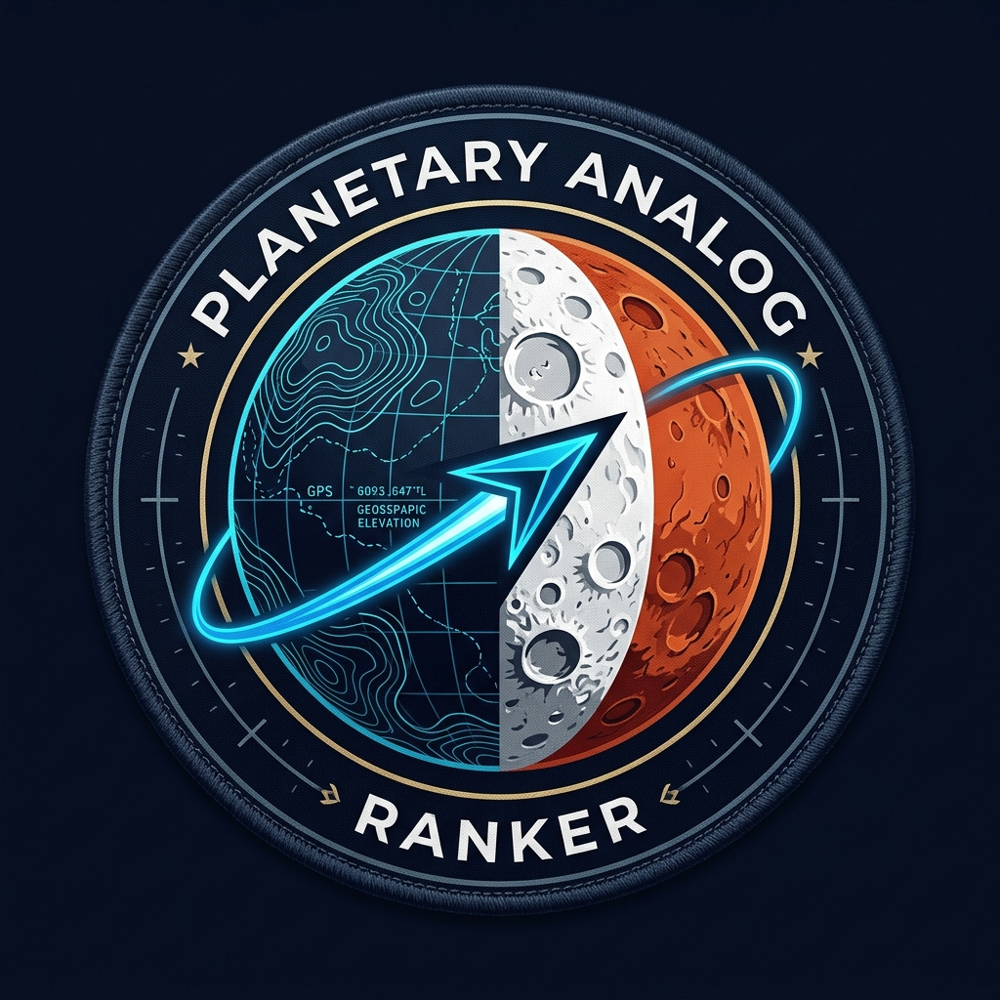

# SubZero: Planetary Analog Ranker & Portfolio Optimizer
### A Decision-Support Engine for Lunar South Pole (Artemis) & Mars Exploration Testing

<p align="center">
  
</p>

[](https://www.python.org/downloads/)
[](https://streamlit.io/)
[](https://python-visualization.github.io/folium/)
[](https://plotly.com/)
[](./tests)

---

## Executive Summary

Before sending astronauts and multimillion-dollar rovers to the **Lunar South Pole** or **Mars**, space agencies (NASA, ESA, JAXA) must test equipment in realistic terrestrial environments. However, **no single Earth location replicates all target conditions**:
- High-latitude polar deserts possess cryogenic cold and polar daylight cycles, but lack volcanic basalt or basaltic dust.
- Shield volcanoes and lava fields provide authentic basaltic regolith and subterranean lava tube caverns, but lack cryogenic cold traps and polar illumination.
- Subtropical hyper-arid deserts feature perchlorates and extreme UV, but lack cryogenic freeze-thaw extremes.

The **SubZero** Planetary Analog Ranker solves this fundamental mission planning bottleneck by:
1. **Multi-Criteria Analog Scoring**: A weighted $0-100$ scoring engine per site across $8$ key planetary environmental parameters, with user-tunable sliders, operational mission presets, and ground-truth physical observation notes.
2. **Greedy Analog Portfolio Finder**: A submodular optimization algorithm that selects a complementary team of $2-3$ Earth test sites to collectively maximize condition coverage and spotlight remaining test deficits.
3. **Dirichlet Monte Carlo Stability Analysis**: A $1,000$-run perturbation simulation that proves which sites are robust against subjective weight variations (with selectable Top-3, Top-5, and Top-10 cutoff tiers).
4. **Benchmark Calibration**: Verified against historical planetary testing grounds (**Atacama Desert**, **Haughton Impact Crater**, and **McMurdo Dry Valleys**).
5. **Dual Radar Profile Alignment**: Interactive side-by-side radar visualizations comparing any Earth site to both ideal benchmarks and measured planetary physical data (LRO Diviner, MOLA, THEMIS).

> [!NOTE]
> **Prototype Phase & Scientific Transparency**: Site scores in this prototype represent expert numerical values calibrated against published NASA and ESA planetary analog field expedition literature. In production, these parameters will be ingested directly from continuous Earth Observation raster datasets (MODIS, SRTM, CHIRPS, Landsat) as detailed in the data provenance section.

---

## Architecture & Core Engine

```
                      ┌──────────────────────────────────────┐
                      │   User Inputs / Mission Presets      │
                      │  (Moon South Pole vs Mars, Sliders)  │
                      └──────────────────┬───────────────────┘
                                         │
                                         ▼
                      ┌──────────────────────────────────────┐
                      │    Weight Normalization (sum = 1.0)  │
                      └──────────────────┬───────────────────┘
                                         │
         ┌───────────────────────────────┼───────────────────────────────┐
         ▼                               ▼                               ▼
┌──────────────────┐           ┌──────────────────┐           ┌──────────────────┐
│  Analog Score    │           │ Portfolio Finder │           │  Rank Stability  │
│      Engine      │           │ (Greedy k-Sites) │           │ (1,000 Dirichlet)│
│ df[cols] @ w     │           │ max marginal cov │           │   Monte Carlo    │
└────────┬─────────┘           └────────┬─────────┘           └────────┬─────────┘
         │                              │                              │
         ▼                              ▼                              ▼
┌──────────────────┐           ┌──────────────────┐           ┌──────────────────┐
│ Interactive Map  │           │ Coverage Bars &  │           │ Calibration &    │
│ & Ranking Table  │           │ Gap Risk Report  │           │ Sensitivity Plot │
└──────────────────┘           └──────────────────┘           └──────────────────┘
```

---

## Mathematical Formulation

### 1. Weighted Analog Score
Given a candidate site $s$ and normalized criteria scores $x_{s,i} \in [0, 100]$:
$$\text{AnalogScore}(s) = \sum_{i=1}^{N} x_{s,i} \cdot w_i \quad \text{where} \quad \sum_{i=1}^{N} w_i = 1.0$$

#### Official NASA Hackathon Worked Example Verification:
Given Moon scores:
- Extreme cold & temp range: $85 \times 0.15 = 12.75$
- Aridity / low humidity: $90 \times 0.15 = 13.50$
- High radiation / UV: $70 \times 0.10 = 7.00$
- Rocky / regolith-like surface: $80 \times 0.15 = 12.00$
- Topographic complexity: $75 \times 0.15 = 11.25$
- Isolation: $60 \times 0.10 = 6.00$
- Polar / high-latitude conditions: $50 \times 0.10 = 5.00$
- Accessibility for testing: $80 \times 0.10 = 8.00$
$$\text{Total Score} = 12.75 + 13.50 + 7.00 + 12.00 + 11.25 + 6.00 + 5.00 + 8.00 = \mathbf{75.50}$$
*(Automated unit test verifies this exact calculation in `tests/test_engine.py`)*.

### 2. Greedy Analog Portfolio Finder
To select a portfolio $S$ of $k$ sites (where $k \in \{2, 3\}$), the algorithm initializes $S = \emptyset$ and cumulative coverage vector $\mathbf{C} = \mathbf{0}$. At step $t \in \{1, \dots, k\}$, it selects:
$$s^* = \arg\max_{s \notin S} \sum_{i=1}^{N} w_i \cdot \max(0, x_{s,i} - C_i)$$
Then updates $C_i \leftarrow \max(C_i, x_{s^*, i})$.
Any criterion where $C_i < \text{threshold}$ (configurable, default $85.0$) is highlighted in the **Mission Gap Report** alongside tailored engineering test mitigations.

### 3. Rank Stability (Simplex Monte Carlo)
Draws $M = 1,000$ weight vectors from a uniform Dirichlet distribution over the simplex:
$$\mathbf{W} \sim \text{Dirichlet}(\alpha_1 = 1, \dots, \alpha_N = 1)$$
Scores all sites across all 1,000 simulated preference profiles and measures the empirical persistence rate:
$$\text{TopNRate}(s) = \frac{1}{M} \sum_{m=1}^{M} \mathbb{I}(\text{Rank}_m(s) \le N) \times 100\%$$
*Configurable cutoff: Top-3 (recommended for 15 sites to clearly separate elite candidates), Top-5 (Tier 1), or Top-10.*

---

## Supported Destinations & Evaluation Criteria

### Moon (South Pole Focus — Artemis Program)
| Criterion | Baseline Weight | Earth Observation Proxy | Target Benchmark (Moon South Pole) |
| :--- | :--- | :--- | :--- |
| **Extreme cold & temperature range** | 15% | MODIS LST, ERA5 Reanalysis | LRO Diviner (PSRs down to 25–50 K) |
| **Aridity / low humidity** | 15% | MODIS Vapor, MERRA-2 | Hard vacuum; desiccated regolith |
| **High radiation / UV** | 10% | OMI UV, Elevation Proxy | Galactic cosmic rays & solar energetic particles |
| **Rocky / regolith surface** | 15% | Landsat-8/9 OLI, Sentinel-2 | Anorthosite & basalt particulate abrasiveness |
| **Topographic complexity** | 15% | SRTM 30m, ASTER GDEM | Steep crater rims (Shackleton, Malapert) |
| **Isolation** | 10% | WorldPop, OSM Logistics | Deep-space autonomy & communication latency |
| **Polar / high-latitude conditions** | 10% | Latitude, Sun Elevation | Low grazing sun angle & elongated shadows |
| **Accessibility for testing** | 10% | Road network, Airport access | Heavy equipment transport feasibility |

### Mars (Global Surface & Volcanic Terrains)
| Criterion | Baseline Weight | Earth Observation Proxy | Target Benchmark (Mars) |
| :--- | :--- | :--- | :--- |
| **Extreme aridity** | 18% | CHIRPS, ERA5 Soil Moisture | Desiccated global surface |
| **Oxidized / iron-rich soils** | 15% | ASTER & Landsat Band Ratios | Hematite, ferric iron oxides (CRISM) |
| **Dust / fine particles** | 12% | Aerosol Optical Depth, Dust Maps | Airborne electrostatic silts |
| **Temperature extremes** | 12% | MODIS LST Diurnal Range | Diurnal swings of >80 K (REMS) |
| **Volcanic / basaltic terrain** | 15% | Geological Survey Maps, ASTER TIR | Tharsis & Elysium shield volcanoes |
| **Impact features / craters** | 10% | Meteorite Impact Databases, DEM | Rampart craters & shatter topography |
| **Salt / perchlorate chemistry** | 8% | Soil assays, Evaporite maps | Phoenix / Curiosity perchlorate salts |
| **Isolation and logistics** | 10% | Population distance, Infrastructure | Expedition autonomous endurance (remoteness only) |

### What is measured and what is estimated

Seven of the eight Moon criteria and four of the eight Mars criteria are computed from open data. No account is needed for any source.

| Criterion | Target | Source | Formula |
| :--- | :--- | :--- | :--- |
| Extreme cold | Moon | ERA5 2019–2023 (Open-Meteo archive) | coldest 1% of nights: +25 °C → 0, −70 °C → 100 |
| Aridity | Moon, Mars | ERA5 2019–2023 | annual precipitation, log scale: ≤5 mm → 100, ≥1,000 mm → 0 |
| Radiation / UV | Moon | NASA POWER (CERES) 2019–2023 | all-day mean UV index: 0 → 0, ≥3 → 100 |
| Topographic complexity | Moon | NASA SRTM 30 m; ASTER GDEM poleward of 56° | elevation spread in a 20 km window, log scale |
| Isolation | Moon, Mars | OpenStreetMap | distance to nearest town or city, log scale: ≤5 km → 0, ≥1,000 km → 100 |
| Polar conditions | Moon | Site latitude | `100 × (|lat|/80)²`, capped at 100 |
| Accessibility | Moon (criterion), Mars (reported separately) | OpenStreetMap | 100 minus log-scaled distance to a commercial airport (up to 60) and a road (up to 40) |
| Temperature extremes | Mars | ERA5 2019–2023 | half cold score, half mean daily swing (25 °C → 100) |
| Impact features | Mars | Wikidata impact structures | 100 inside a confirmed structure, halving every 40 km beyond its rim |

Still hand estimates: rocky surface (Moon); iron-rich soils, dust, volcanic terrain and salts (Mars).
Volcanic terrain was tested against the Smithsonian volcano database but left as an estimate, because the database
only covers young volcanoes and misses ancient basalt such as the Pilbara.

NASA POWER temperature and precipitation are stored as a cross-check (`power_*` columns). Its 50 km grid is too
coarse for summits and basins, so ERA5 drives those scores; the Validation tab shows where the two differ.

Raw values are in `data/measured.csv`; `python data/fetch_measured.py` rebuilds them (standard library only).
The **Score data** switch in the sidebar shows measured or estimated scores, and the Validation tab compares the two.

### Checks built into the app

- **Resemblance versus accessibility.** Accessibility is reported separately for both targets, so "looks like the target" is not mixed with "easy to work at". Mars keeps the guide's eight criteria and weights unchanged.
- **Greedy versus best portfolio.** The greedy pick the guide asks for is shown next to the true best combination (exhaustive search).
- **Too close to call.** Every score is shifted by up to ±5 points 1,000 times; a site that takes first place in at least 10% of trials is flagged.
- **Rank stability.** Around the current weights (default) or across all possible weightings.
- **Overlapping criteria.** Strongly correlated criteria are listed, with an option to count them once.


---

## Curated Earth Analog Sites

The repository includes quantitative characterization and physical observation notes for 15+ globally distributed analog sites:
1. **McMurdo Dry Valleys (Antarctica)**: Hyperarid polar desert, cryogenic winds, sublimation permafrost.
2. **Haughton Impact Crater (Devon Island, Canada)**: 23-km meteorite crater in Arctic permafrost, shatter cones.
3. **Atacama Desert (Chile)**: Hyperarid core, reactive soil oxidants, high UV, perchlorate salts.
4. **Mauna Kea & Mauna Loa (HI-SEAS, Hawaii)**: Basaltic volcanic tephra, lava tubes, high-altitude isolation.
5. **Askja Caldera & Holuhraun (Iceland)**: Historic Apollo astronaut training ground, fresh basaltic lava fields.
6. **Concordia Station (Dome C, Antarctica)**: Cryogenic thermal analog (-80°C), 9 months complete isolation.
7. **Svalbard (AMASE, Norway)**: High Arctic permafrost, mantle xenoliths, carbonate globules (ALH84001 analog).
8. **Mojave Desert / Pisgah Crater (Desert RATS, USA)**: Cinder cones, basaltic lava flows, rover testing hub.
9. **Teide Caldera (Tenerife, Spain)**: High-altitude blocky basalt fields, ESA ExoMars rover testing.
10. **Qaidam Basin (Tibetan Plateau, China)**: Highest hyperarid yardang desert on Earth, high UV, saline crusts.
11. **Danakil Depression (Ethiopia)**: Hydrothermal acidic brines, iron oxy-hydroxides, extreme heat.
12. **Namib Desert (Namibia)**: Red oxidized quartz sand dunes, wind abrasion, dune mobility.
13. **Pilbara Craton (Western Australia)**: 3.5 Ga Archaean banded iron formations and ancient stromatolite fossils.
14. **Wadi Rum Protected Area (Jordan)**: "Valley of the Moon" red sandstone monoliths, canyon mobility, rover autonomy.
15. **Sudbury Impact Basin (Canada)**: 1.85 Ga ancient impact crater, impact melt sheets, shatter cones.
16. **Rio Tinto (Spain)**: Acidic ferric iron river, jarosite precipitates (Meridiani Planum analog).

---

## Benchmark Calibration Verification

The platform supports two evaluation modes: **Measured Physical Data** (the app's default mode, driven by continuous open climate, elevation, and infrastructure datasets) and **Expert Literature Estimates**. Live scoring confirms that established NASA and ESA testing grounds rank in close alignment with physical planetary science:

### 1. Measured Physical Data Mode (App Default)
*In Measured mode, seven of eight Moon criteria and four of eight Mars criteria are computed directly from open datasets (ERA5 reanalysis, NASA POWER CERES UV, NASA SRTM 30m / ASTER GDEM relief, and OpenStreetMap).*

| Candidate Site | Planetary Target | Measured Score | Rank (Candidates) | Physical Ground-Truth Finding |
| :--- | :--- | :---: | :---: | :--- |
| **Concordia Station (Dome C)** | Moon South Pole | **66.9** | **1** | Coldest $-68.4^\circ\text{C}$ winter reanalysis temperatures & extreme polar aridity; holds 1st in 88.6% of noise trials |
| **McMurdo Dry Valleys** | Moon South Pole | **64.9** | **2** | Exceptional cryogenic aridity; narrow statistical tie with Concordia (wins 10.1% of noise trials) |
| **Atacama Desert (Yungay)** | Moon South Pole | **64.2** | **3** | Peak solar UV and desiccated surface; lacks high-latitude polar cold |
| **Haughton Impact Crater** | Moon South Pole | **61.7** | **4** | Arctic permafrost combined with verified impact shatter topography |
| **Atacama Desert (Yungay)** | Mars | **73.4** | **1** | Global leader in hyper-aridity, UV flux, and perchlorate soil chemistry |
| **Haughton Impact Crater** | Mars | **62.5** | **4** | Peak impact crater terrain (98/100) and polar desert gravels |
| **McMurdo Dry Valleys** | Mars | **62.3** | **6** | Desiccated sandstone and cryogenic ground ice; penalized by remote Antarctic logistics |

### 2. Expert Estimates Mode (Literature Baseline)
*In Estimates mode, criteria reflect initial normalized suitability values curated from published analog expedition reports:*

| Known Analog | Planetary Target | Literature Score | Rank | Physical Reality Check |
| :--- | :--- | :---: | :---: | :--- |
| **McMurdo Dry Valleys** | Moon South Pole | **82.8** | **1** | Polar cold desert benchmark; penalized only by remote logistics |
| **Haughton Impact Crater** | Moon South Pole | **79.3** | **2** | 23-km meteorite crater in permafrost mimicking complex lunar topography |
| **Atacama Desert** | Moon South Pole | **70.6** | **8** | Extreme UV and dryness, but accurately penalized for temperate latitude |
| **Atacama Desert** | Mars | **84.0** | **1** | Unequalled soil chemistry, perchlorate oxidants, and extreme dryness |
| **McMurdo Dry Valleys** | Mars | **82.3** | **2** | Sub-zero desiccated regolith and polygon permafrost ground ice |
| **Haughton Impact Crater** | Mars | **75.2** | **6** | Impact melt sheets, deep gullies, and shatter cone geology |

---

## Installation & Quickstart

### Prerequisites
- Python 3.10+
- Linux, macOS, or Windows

### Setup
Needs Python 3.10 or newer. Works on macOS, Windows and Linux.

**Quick start** (creates a local environment on first run, then opens the app):

| System | Command |
| :--- | :--- |
| macOS / Linux | `./run.sh` |
| Windows | double-click `run.bat`, or run `run.bat` in a terminal |

**Manual setup**

```bash
# macOS / Linux
python3 -m venv .venv
.venv/bin/python -m pip install -r requirements.txt
.venv/bin/python -m unittest discover -s tests -v
.venv/bin/python -m streamlit run app.py
```

```bat
:: Windows
py -3 -m venv .venv
.venv\Scripts\python -m pip install -r requirements.txt
.venv\Scripts\python -m unittest discover -s tests -v
.venv\Scripts\python -m streamlit run app.py
```

The app opens at http://localhost:8501.

### Deploy to Streamlit Community Cloud
1. Push your repository to GitHub.
2. Sign in to [share.streamlit.io](https://share.streamlit.io/) with your GitHub account.
3. Select this repository and set the main file path to `app.py`.
4. Deploy to get a public link for the judges.

---

## Project Demo Outlines

### A. Official NASA Fast Pitch (30 Seconds or Less)
*Adheres to the official 2026 NASA Space Apps 30-second video limit for Global Judging eligibility:*

| Timestamp | Section | Key Visuals & Talking Points |
| :--- | :--- | :--- |
| **0:00 – 0:05** | **Introduction** | *"We are team SubZero, presenting SubZero: the Planetary Analog Ranker & Portfolio Optimizer."* Show mission patch and dashboard. |
| **0:05 – 0:12** | **The Bottleneck** | *"Testing Artemis and Mars equipment across mismatched Earth environments risks catastrophic mission failure."* |
| **0:12 – 0:22** | **The Engine & Optimization** | *"Our platform ingests NASA SRTM, CERES, and ERA5 data to score sites across 8 planetary criteria, then uses submodular greedy optimization to select complementary multi-site test portfolios that eliminate critical test gaps."* Show live map & Tab 3 portfolio solver. |
| **0:22 – 0:30** | **Validation & Impact** | *"Backed by 1,000 Dirichlet Monte Carlo simulations, we're replacing subjective expedition planning with data-driven science."* |

### B. Extended 2.5-Minute Video Walkthrough Script

| Timestamp | Section | Key Talking Points & Visual Actions |
| :--- | :--- | :--- |
| **0:00 – 0:20** | **The Problem** | *"No single Earth site is a perfect analog for the Moon or Mars. Testing rovers and habitats across mismatched sites risks mission failure."* Show dashboard and prototype banner. |
| **0:20 – 1:00** | **The Ranked Map** | Toggle between Moon South Pole and Mars. Switch to **Rover mobility** preset; watch sliders and map update. Click markers to reveal top parameter values and constraints. |
| **1:00 – 1:35** | **Portfolio Finder** | Open Tab 3. Set $k=2$ and $thr=85$; observe remaining gaps (e.g. Topographic complexity). Increase $k$ to $3$; observe how Askja or Mauna Kea closes the gap. Review tailored gap advice. |
| **1:35 – 2:05** | **Validation** | Show Tab 4. Select the **Top 3** cutoff to show sharp separation. Walk through the live-generated calibration findings and open data agreement matrix. |
| **2:05 – 2:30** | **Radar & Roadmap** | Inspect a site's radar profile against measured planetary physical data (LRO/MOLA). Point to the NASA Earth Observation data provenance table and outline automated raster ingestion next steps. |

---

## References & Key Literature

1. **Lunar South Pole Thermal Environment**: Paige, D. A., et al. (2010). *Diviner Lunar Radiometer Experiment: Thermal environment of the Lunar South Pole.* Science, 330(6003), 479-482.
2. **Lunar Surface Topography & Slopes**: Barker, M. K., et al. (2016). *A new lunar digital elevation model from the Lunar Orbiter Laser Altimeter (LOLA).* Icarus, 273, 346-355.
3. **Mars Diurnal Surface Meteorology**: Harri, A. M., et al. (2014). *Pressure and temperature measurements at the Curiosity landing site by REMS.* Journal of Geophysical Research: Planets, 119(1), 82-92.
4. **Global Atmospheric Reanalysis**: Hersbach, H., et al. (2020). *The ERA5 global reanalysis.* Quarterly Journal of the Royal Meteorological Society, 146(730), 1999-2049.
5. **Solar Radiation & UV Climatology**: Stackhouse, P. W., et al. (2021). *NASA Prediction of Worldwide Energy Resources (POWER) Project.* NASA Langley Research Center.
6. **Digital Elevation Models**: Farr, T. G., et al. (2007). *The Shuttle Radar Topography Mission (SRTM).* Reviews of Geophysics, 45(2).
7. **Atacama Mars Analog Astrobiology**: Navarro-González, R., et al. (2003). *Mars-like soils in the Atacama Desert, Chile, and the dry limit of microbial life.* Science, 302(5647), 1018-1021.
8. **Haughton-Mars Project Analog**: Lee, P., & Osinski, G. R. (2005). *The Haughton-Mars Project: Arctic Mars analog field research.* Lunar and Planetary Institute Contributions.
9. **Antarctic Dry Valleys Analog Research**: McKay, C. P., et al. (1998). *Cold desert ecosystems: Antarctic Dry Valleys as an analog for Mars.* Antarctic Science, 10(2), 127-133.

---

## Hackathon Team Roles & Contributions

- **Data and Science Lead**: Curated quantitative analog parameters, defined normalization thresholds, structured NASA/ESA mission citations, authored scientific justification cards.
- **Developer Lead**: Architected Streamlit UI, built reactive Folium map integration, developed Plotly radar polar charts, created the greedy portfolio finder and Dirichlet Monte Carlo simulation.
- **Story and Validation Lead**: Formulated test suites (NASA 75.5 check), benchmarked calibration against known analogs, authored README documentation and demo video script.

---

## License
This project is open-source under the MIT License.
